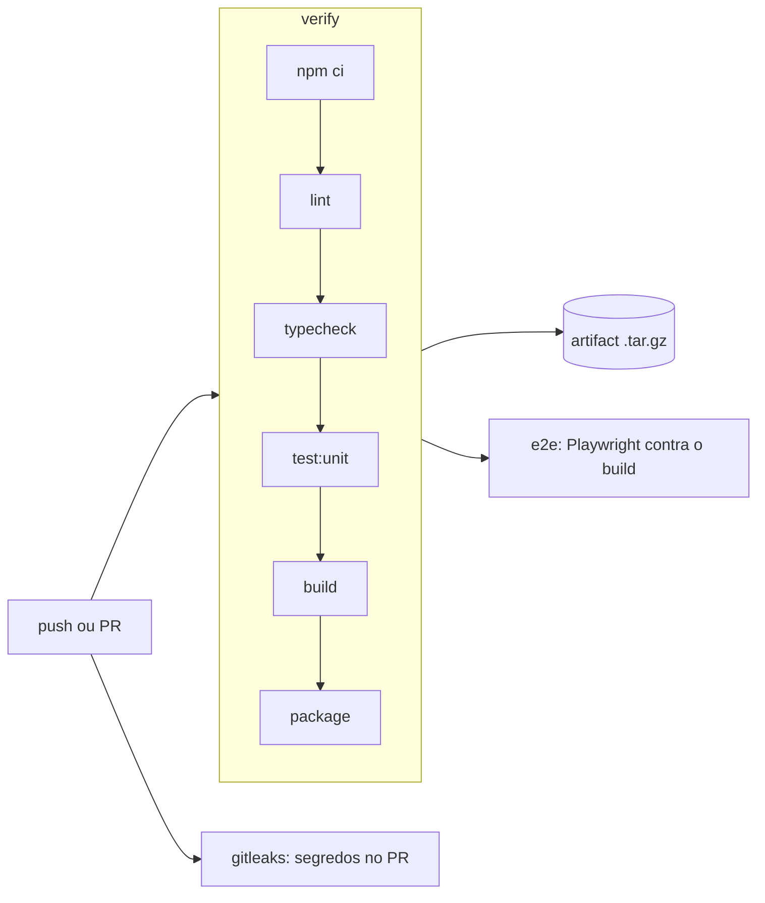

# Gerenciamento do processo de build e automação

Detalhamento da atividade "Gerenciamento do processo de construção (Build) e automação (Maven, Gradle, npm)". A síntese está em [`RELATORIO-BUILD.md`](../../RELATORIO-BUILD.md).

## 1. O que é o build, e por que automatizar

Build é o caminho que leva o código-fonte a um sistema pronto para rodar. No Banco de Sangue esse caminho tem cinco passos:

1. baixar as dependências;
2. conferir o código (lint e checagem de tipos);
3. rodar os testes;
4. compilar a versão de produção;
5. empacotar o resultado.

Feito à mão, cada pessoa da equipe roda os passos de um jeito, em versões diferentes de Node, e ninguém garante que os testes rodaram antes do deploy. Uma ferramenta de build resolve três coisas:

- **Repetibilidade:** o mesmo comando dá o mesmo resultado em qualquer máquina e no CI.
- **Dependências:** as bibliotecas são baixadas nas versões certas, sem ninguém copiar arquivo.
- **Ciclo de vida:** os passos rodam numa ordem fixa, e um passo que falha interrompe os seguintes.

## 2. Maven, Gradle e npm

As três ferramentas cumprem o mesmo papel em ecossistemas diferentes. Maven e Gradle são do mundo Java; npm é do mundo JavaScript, onde o Banco de Sangue vive (Next.js e TypeScript).

| Conceito | Maven | Gradle | npm (este projeto) |
|---|---|---|---|
| Arquivo de build | `pom.xml` (XML declarativo) | `build.gradle(.kts)` (código Groovy/Kotlin) | [`package.json`](../../package.json) (JSON) |
| Identidade do projeto | `groupId:artifactId:version` | `group`, `name`, `version` | `name` e `version` (1.3.0) |
| Repositório de bibliotecas | Maven Central | Maven Central, Google | registro npm (npmjs.com) |
| Cache local | `~/.m2/repository` | `~/.gradle/caches` | cache do npm e `node_modules/` |
| Versões travadas | versão exata no `pom.xml` | *dependency locking* (`gradle.lockfile`) | [`package-lock.json`](../../package-lock.json) + `npm ci` |
| Escopo de dependência | `compile` / `test` / `provided` | `implementation` / `testImplementation` | `dependencies` / `devDependencies` |
| Ciclo de vida | fases fixas: validate, compile, test, package, verify, install, deploy | grafo de tarefas: check, test, assemble, build | scripts nomeados + ganchos `pre`/`post` |
| Extensão | plugins ligados a fases | plugins e tarefas customizadas | scripts e ferramentas em `devDependencies` |
| Artefato | `.jar` / `.war` | `.jar` / `.war` | pacote `.tar.gz` com o servidor standalone do Next |
| Versão do ambiente | `maven-enforcer-plugin` (Java) | *toolchains* | `engines` + [`.nvmrc`](../../.nvmrc) |
| Wrapper | `mvnw` | `gradlew` | o npm já vem com o Node |

**Diferença principal:** o Maven impõe um ciclo de vida fixo (convenção acima de configuração); o Gradle monta um grafo de tarefas com build incremental; o npm não impõe ciclo nenhum, só executa scripts. Por isso, no npm, **a equipe precisa desenhar o próprio ciclo**, e foi isso que faltava no projeto.

### O ciclo de vida do Maven, montado em npm

| Fase Maven | Tarefa Gradle | Script npm | O que faz aqui |
|---|---|---|---|
| `validate` | `check` (parte) | `npm run lint` | ESLint 9 com as regras do Next.js |
| `compile` | `compileJava` | `npm run typecheck` | `tsc --noEmit` sobre telas, rotas da API e bibliotecas |
| `test` | `test` | `npm run test:unit` (= `npm test`) | 82 testes Jest de unidade e de API |
| `package` | `assemble` | `npm run build` → `postbuild` → `npm run package` | build de produção, servidor standalone e `.tar.gz` |
| `verify` | `build` | `npm run verify` | lint, tipos, testes e build, em ordem, parando na primeira falha |
| `integration-test` | `integrationTest` | `npm run test:e2e` | 5 testes Playwright pela interface, contra o servidor de produção |
| `deploy` | `publish` | [workflow de release](../../.github/workflows/release.yaml) | publica a Release no GitHub com o pacote |

O gancho `postbuild` faz o papel de um plugin ligado a uma fase no Maven: o npm o executa sozinho depois de `build`, sem ninguém precisar lembrar.

## 3. Como o build estava (diagnóstico)

Saídas completas em [`evidencias/antes/`](./evidencias/antes/).

| # | Problema | Evidência | Consequência |
|---|---|---|---|
| 1 | **CI quebrado:** `ubuntu-latest` passou a ser Ubuntu 26.04 e o Playwright 1.57 não instala nele | [run 41578095839](https://github.com/AugustoAzev/banco-de-sangue/actions/runs/41578095839), 03/11/2026 | todo PR desde então fica vermelho, inclusive as atualizações do Dependabot |
| 2 | **CI que não testava nada:** `npx playwright test \|\| echo` passava mesmo com falha; os testes Jest não estavam no CI | [`homologacao.yaml` antigo](https://github.com/AugustoAzev/banco-de-sangue/blob/234840a/.github/workflows/homologacao.yaml) | "verde" no CI não queria dizer nada |
| 3 | **`npm test` quebrado:** rodava o Playwright, que pegava os arquivos do Jest e encontrava 0 testes | [`07-npm-test.txt`](./evidencias/antes/07-npm-test.txt) | o comando padrão de teste falhava |
| 4 | **Testes E2E abandonados:** apontavam para `localhost:5173`, endereço da época do Vite | specs antigos | nunca rodaram contra o sistema atual |
| 5 | **`npm run lint` travado:** `next lint` (descontinuado) sem ESLint instalado abre uma pergunta interativa | [`01-npm-run-lint.txt`](./evidencias/antes/01-npm-run-lint.txt) | impossível usar em automação |
| 6 | **Checagem de tipos incompleta:** o `tsconfig.json` não incluía `pages/`; num clone limpo, 0 das 14 rotas da API eram verificadas | [`02-tsc.txt`](./evidencias/antes/02-tsc.txt) | erros de tipo na API passariam |
| 7 | **Ambiente solto:** sem `engines` nem `.nvmrc`; Node 22 local, 20 no CI, "18+" no README | `package.json` antigo | "na minha máquina funciona" |
| 8 | **Dependências vulneráveis:** 10 falhas nas dependências de produção (1 crítica no Next, 8 altas) | [`06-npm-audit.txt`](./evidencias/antes/06-npm-audit.txt) | risco real em produção |
| 9 | **Dependência sem uso:** `react-router-dom` (o Next tem roteamento próprio), com 2 das falhas acima | `grep` sem resultados | peso e risco sem benefício |
| 10 | **Segredos no repositório público:** `vercel.json` com `JWT_SECRET` e `SUPABASE_SERVICE_ROLE_KEY` desde 27/06/2026 | commits `0778a21`, `eceacd1`, `f683edb` | qualquer pessoa podia assinar tokens e acessar o banco sem restrição |
| 11 | **Sem artefato:** o build só existia dentro da pasta `.next` de quem rodou | — | nada versionado para entregar ou instalar |

## 4. O que foi feito

### Ciclo de vida em npm ([`package.json`](../../package.json))

```text
npm run verify
  ├─ lint        eslint .
  ├─ typecheck   tsc --noEmit
  ├─ test:unit   jest --runInBand
  └─ build       next build
       └─ postbuild   prepara o servidor standalone (gancho automático do npm)
npm run package  gera dist/banco-de-sangue-<versão>.tar.gz
npm run test:e2e playwright test (sobe o servidor sozinho)
npm start        node .next/standalone/server.js
```

- `engines.node >= 20.9` e `.nvmrc` com Node 22, lido pelo CI.
- ESLint 9 com [`eslint.config.mjs`](../../eslint.config.mjs). Os 5 `catch (err: any)` das telas viraram `catch (err)` com o auxiliar tipado [`apiErrorDetail`](../../src/services/api.ts). Nos testes, `any` continua permitido (são objetos falsos de requisição).
- [`tsconfig.json`](../../tsconfig.json) passou a incluir `pages/`: 14 de 14 rotas verificadas.
- [`next.config.js`](../../next.config.js) com `output: 'standalone'`: o build gera um servidor Node que leva só as dependências usadas.
- [`scripts/preparar-standalone.mjs`](../../scripts/preparar-standalone.mjs) (gancho `postbuild`) e [`scripts/empacotar-build.mjs`](../../scripts/empacotar-build.mjs) (fase `package`). O pacote leva um `BUILD-INFO.json` com versão, commit e data, e **nunca leva o `.env`**: o Next copia o `.env` para o standalone, e o script o remove.

### Dependências

- `next` 15.5.19 → 15.5.29 (mesma versão maior), `npm audit fix` nas indiretas e remoção do `react-router-dom`.
- Resultado nas dependências de produção: **10 falhas (1 crítica, 8 altas) → 2 (1 alta, 1 moderada)**. As duas restantes só são corrigidas no Next 16 (mudança de versão maior, com quebras), e por isso ficam registradas como decisão consciente, como foi feito no TP3 com o TypeScript 7.
- Nas dependências de desenvolvimento ficaram falhas baixas e moderadas na cadeia do Jest; a correção sugerida pelo npm seria voltar ao Jest 25, o que não faz sentido.
- O Dependabot (já configurado em [`.github/dependabot.yml`](../../.github/dependabot.yml)) continua abrindo PRs semanais, e agora esses PRs passam por um CI que testa de verdade.

### Testes de ponta a ponta

- [`playwright.config.ts`](../../playwright.config.ts): só arquivos `*.spec.js`, endereço configurável e servidor de produção iniciado pelo próprio Playwright.
- [`tests/login.spec.js`](../../tests/login.spec.js) e [`tests/dashboard.spec.js`](../../tests/dashboard.spec.js) reescritos para a interface atual, com o login em [`tests/e2e-helpers.js`](../../tests/e2e-helpers.js).

### Pipeline de CI ([`homologacao.yaml`](../../.github/workflows/homologacao.yaml))



- Sistema fixado em `ubuntu-24.04` e Node lido do `.nvmrc`: o pipeline não muda sozinho.
- Ações atualizadas (checkout, setup-node e upload-artifact v7, cache v6), todas em Node 24.
- Cache do npm e do `.next/cache` entre execuções.
- O pacote fica disponível como *artifact* por 14 dias.
- Testes E2E sem `|| echo`: se falharem, o pipeline fica vermelho e o relatório do Playwright é publicado. O job só roda quando os segredos do banco estão cadastrados no repositório; sem eles, é pulado com aviso.
- **gitleaks** procura segredos em todo PR.
- `concurrency` cancela execuções velhas da mesma branch.

### Release automatizada ([`release.yaml`](../../.github/workflows/release.yaml))

Enviar a tag `v1.3.0` dispara: conferência de que a tag bate com o `package.json`, `npm ci`, `npm run verify`, `npm run package` e publicação da Release no GitHub, com o `.tar.gz` anexado e as notas tiradas do [`CHANGELOG.md`](../../CHANGELOG.md).

### Segredos

O bloco `env` saiu do [`vercel.json`](../../vercel.json). As variáveis ficam só no painel da Vercel, nos segredos do GitHub e no `.env` local (que já estava no `.gitignore`).

> **Ação pendente da equipe:** apagar do arquivo não apaga do histórico do git. As chaves ficaram públicas por quase cinco meses e **precisam ser trocadas**: gerar uma nova service role key e um novo JWT secret no Supabase, e um novo `JWT_SECRET` na Vercel e no `.env` de cada um. Antes do merge, confirmar que as quatro variáveis estão cadastradas no painel da Vercel, senão o deploy perde a configuração.

## 5. Resultado

Saídas completas em [`evidencias/depois/`](./evidencias/depois/).

| Item | Antes | Depois |
|---|---|---|
| `npm run lint` | travava pedindo configuração | 0 erros, 7 avisos ([lista](#avisos-de-lint-que-ficaram)) |
| Rotas da API na checagem de tipos (clone limpo) | 0 de 14 | 14 de 14 |
| `npm test` | falhava, 0 testes | 82 testes Jest aprovados |
| Testes E2E | apontavam para outro sistema | 5 aprovados contra o pacote extraído e iniciado com `node server.js` |
| Testes no CI | nenhum de verdade | lint, tipos, 82 de unidade e 5 E2E |
| CI no Ubuntu 26.04 | vermelho desde 03/11 | sistema fixado em 24.04 |
| Falhas em dependências de produção | 10 (1 crítica) | 2 (dependem do Next 16) |
| Artefato | nenhum | `banco-de-sangue-1.3.0.tar.gz`, 17,5 MB, em todo push |
| Segredos no repositório | 2 chaves públicas | nenhum no código; gitleaks nos PRs |
| Comando único para validar tudo | não existia | `npm run verify` (91 s numa máquina da equipe) |

### Avisos de lint que ficaram

Seis avisos `react-hooks/exhaustive-deps` (doadores, estoque, insumos, `AuthContext`, `ToastContext`) e um `@next/next/no-img-element` na tela de login. Corrigir as dependências dos `useEffect` muda quando as telas recarregam os dados, e por isso fica para uma manutenção própria, com teste de regressão. Eles aparecem em toda execução do lint, e ninguém perde de vista.

## 6. Como reproduzir

```bash
nvm use                 # Node 22, lido do .nvmrc
npm ci                  # dependências exatamente como no package-lock.json
npm run verify          # lint, tipos, testes de unidade e build
npm run package         # gera dist/banco-de-sangue-1.3.0.tar.gz
npm run test:e2e        # precisa do .env (usa o banco real)
```

Para instalar o pacote em outra máquina: extrair o `.tar.gz`, criar o `.env` a partir do `.env.example` e rodar `node server.js` (porta 3000, ou a definida em `PORT`).
